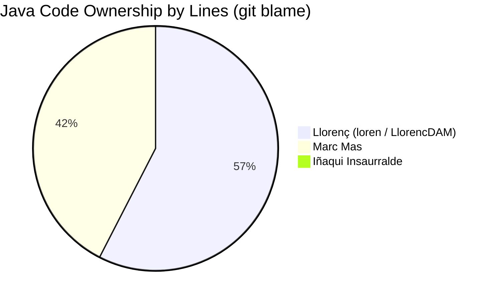

# Code Quality Review & Team Rating: Penguin Runner (Java)

This document provides a comprehensive code review of the original Java codebase for **Penguin Runner** (`PenguinRunner/src/main/java/iessineu/penguinrunner/`). It evaluates the engineering practices used across every file based on `git blame`, architectural patterns, maintainability, performance, and robustness, culminating in individual performance ratings for each team member.

---

## 1. Executive Summary & Team Overview

Across **30 Java source files** (excluding vendored third-party libraries), the codebase contains **7,534 lines of code**. The development was heavily concentrated among two developers, with a third developer focusing on map data and sprite assets.



| Member | Git Commits | Blame Lines | % of Code | Primary Responsibilities | Final Rating |
| :--- | :---: | :---: | :---: | :--- | :---: |
| **Llorenç Gayà** (`loren`, `LlorencDAM`) | 61 | 4,308 | 57.2% | Pathfinding AI, Autotiling, State Pattern, Menus & Level Editor GUI | **8.2 / 10** |
| **Marc Mas** (`Marc Mas`) | 270 | 3,177 | 42.2% | System Integration, Engine Lifecycle, Audio, Items, Modding, Persistence | **8.0 / 10** |
| **Iñaqui Insaurralde** (`InaquiIns35`, `Insaurralde Iñaqui`) | 15 | 49 | 0.6% | Level Design (`maps.json`), Sprite Assets, Player Lives Stub | **4.5 / 10** |

---

## 2. File-by-File Analysis & Ratings

Each file has been rated on a scale of **1.0 to 10.0** based on architectural soundness, error handling, readability, and performance.

### 2.1 Core Engine & Application Lifecycle

#### [`PenguinRunner.java`](file:///c:/Users/Marc%20Mas/Documents/Code/Penguin%20Runner/PenguinRunner/src/main/java/iessineu/penguinrunner/PenguinRunner.java)
- **Blame Distribution**: Marc Mas (93 lines / 90.3%), Llorenç (10 lines / 9.7%)
- **Rating**: **6.5 / 10**
- **Analysis**:
  - **Practices**: Handles CLI argument parsing (`-game`, `-mod`, `-editor`, `-skip`) and launches either the map studio or main game.
  - **Strengths**: Good initiative implementing command-line modding and standalone editor flags.
  - **Weaknesses**:
    - CLI parsing uses manual parallel array resizing with `Arrays.copyOf()` and sentinel values (`"-1"`) in lines 24–35 instead of a `Map<String, String>` or simple token scanner.
    - `cls()` prints 100 blank lines to console.
    - Application flow polls menu readiness via a `Timer` (`new Timer(200, e -> arrancar(menu))`) rather than using an event listener or callback pattern.

#### [`GameFrame.java`](file:///c:/Users/Marc%20Mas/Documents/Code/Penguin%20Runner/PenguinRunner/src/main/java/iessineu/penguinrunner/GameFrame.java)
- **Blame Distribution**: Llorenç (33 lines / 56.9%), Marc Mas (25 lines / 43.1%)
- **Rating**: **7.5 / 10**
- **Analysis**:
  - **Practices**: Standard Swing `JFrame` container hosting `GamePanel`.
  - **Strengths**: Clean, minimal window configuration with `setDefaultCloseOperation(JFrame.EXIT_ON_CLOSE)`, `setResizable(false)`, and window centering via `setLocationRelativeTo(null)`.
  - **Weaknesses**: Contains commented-out timer and menu initialization code from previous architectural iterations.

#### [`GamePanel.java`](file:///c:/Users/Marc%20Mas/Documents/Code/Penguin%20Runner/PenguinRunner/src/main/java/iessineu/penguinrunner/GamePanel.java)
- **Blame Distribution**: Marc Mas (515 lines / 68.9%), Llorenç (231 lines / 30.9%), Iñaqui (1 line / 0.1%)
- **Rating**: **6.8 / 10**
- **Analysis**:
  - **Practices**: Central Swing rendering loop and keyboard event dispatcher.
  - **Strengths**: Smooth 20ms rendering timer (`new Timer(20, e -> repaint())`), dynamic panel resizing based on loaded map dimensions (`resizePanelToGame`), clean key-binding routing.
  - **Weaknesses**:
    - **Resource Leak / Allocation in Render Loop**: In `drawHUD()` (lines 545–553), `ClassLoader.getResourceAsStream("sprites/selected.png")` and `ImageIO.read()` were called **every 20 milliseconds inside the paint loop**, causing disk/JAR reads and heap churn on every render tick.
    - **State Mutation During Paint**: In the HUD item selection carousel (lines 522–543), `player.nextItem()` was repeatedly invoked inside `drawHUD` to calculate positions and then reset with `player.setSelectedItemIndex(originalPointer)`. Mutating domain state inside `paintComponent` is a major code smell and caused the 1-item HUD wheel glitch.
    - Dummy `new Block(...)` instances are instantiated on the fly solely to draw HUD text and icons.

#### [`GameState.java`](file:///c:/Users/Marc%20Mas/Documents/Code/Penguin%20Runner/PenguinRunner/src/main/java/iessineu/penguinrunner/GameState.java)
- **Blame Distribution**: Marc Mas (991 lines / 50.2%), Llorenç (976 lines / 49.4%), Iñaqui (9 lines / 0.4%)
- **Rating**: **6.0 / 10**
- **Analysis**:
  - **Practices**: The central game coordinator representing 1,976 lines of game logic.
  - **Strengths**: Rich, functioning game mechanics: turn management, ladder transitions, timed block breaking and regeneration, trapdoors, ice melting, save/load serialization, and AI dispatch.
  - **Weaknesses**:
    - **"God Class" Anti-Pattern**: Violates the Single Responsibility Principle (SRP). It combines map JSON parsing, tile physics, gravity timers, turn stepping, audio triggering, level progression, enemy AI orchestration, and binary serialization in a single file.
    - Heavy use of `instanceof` checks (`if (enemy instanceof AmbushingEnemy)`) instead of polymorphic method dispatch on the `Enemy` base class.

---

### 2.2 Rendering & Audio Subsystems

#### [`Printable.java`](file:///c:/Users/Marc%20Mas/Documents/Code/Penguin%20Runner/PenguinRunner/src/main/java/iessineu/penguinrunner/Printable.java)
- **Blame Distribution**: Marc Mas (168 lines / 100%)
- **Rating**: **7.0 / 10**
- **Analysis**:
  - **Practices**: Base class for all visible entities (Blocks, Player, Enemies, Items).
  - **Strengths**:
    - **Resilient Fallback Pipeline**: If a PNG sprite cannot be found or fails to load, it automatically falls back to rendering a centered Unicode/Emoji glyph using `TextLayout` with anti-aliasing hints. This prevented missing assets from crashing the game.
  - **Weaknesses**:
    - **Static Mutable State**: Contains `static Graphics g` and `static Font font`. The panel sets `Printable.setGraphics(g)` during rendering so entities can call `draw()`. Storing the active Swing `Graphics` context in a static field breaks thread safety and makes unit testing or multi-window rendering impossible.
    - High coupling: Models inherit from `Printable` rather than separating the domain representation from the view/renderer.

#### [`SoundManager.java`](file:///c:/Users/Marc%20Mas/Documents/Code/Penguin%20Runner/PenguinRunner/src/main/java/iessineu/penguinrunner/SoundManager.java)
- **Blame Distribution**: Marc Mas (258 lines / 82.7%), Llorenç (54 lines / 17.3%)
- **Rating**: **8.5 / 10**
- **Analysis**:
  - **Practices**: Audio playback using `javax.sound.sampled` (`Clip`, `AudioInputStream`).
  - **Strengths**:
    - Proper handling of `transient Clip musicClip` so `GameState` can be serialized to disk without throwing `NotSerializableException`.
    - Proper logarithmic decibel scaling for volume control via `FloatControl.Type.MASTER_GAIN` (`20f * (float) Math.log10(volume)`).
    - Supports both internal JAR resource audio and external modded sound files.
  - **Weaknesses**: Minor code duplication between sound effect playing and music playing.

#### [`IceAutoTileConnector.java`](file:///c:/Users/Marc%20Mas/Documents/Code/Penguin%20Runner/PenguinRunner/src/main/java/iessineu/penguinrunner/IceAutoTileConnector.java)
- **Blame Distribution**: Llorenç (280 lines / 97.9%), Marc Mas (6 lines / 2.1%)
- **Rating**: **9.2 / 10**
- **Analysis**:
  - **Practices**: 8-neighbor bitmasking for procedural 2D tile connectivity (Wang / 47-tile autotiler).
  - **Strengths**:
    - **Algorithmic Excellence**: Correctly implements bitwise flags (`N=1, E=2, S=4, W=8, NE=16, SE=32, SW=64, NW=128`) with edge-conditional diagonal masking (lines 94–100: diagonals only count if both adjacent cardinal edges exist).
    - Clear mapping between bitmask combinations and asset names (`ice_c_tl`, `ice_t`, etc.).
  - **Weaknesses**: Slight method overhead scanning the full grid on every call without a dirty-flag check, but negligible for 32x22 grids.

---

### 2.3 UI, Menus & Developer Tooling

#### [`AsciiMapStudio.java`](file:///c:/Users/Marc%20Mas/Documents/Code/Penguin%20Runner/PenguinRunner/src/main/java/iessineu/penguinrunner/AsciiMapStudio.java)
- **Blame Distribution**: Llorenç (564 lines / 92.5%), Marc Mas (46 lines / 7.5%)
- **Rating**: **9.0 / 10**
- **Analysis**:
  - **Practices**: Custom in-game level editor built with Swing (`JTable`, `DefaultComboBoxModel`, GSON).
  - **Strengths**:
    - Outstanding tooling initiative: built a dedicated map editor with live grid painting (right-click paint mode, character selector toolbar), dimension spinners, level duplication, and JSON serialization.
    - Custom table cell renderer and editor (`OneCharEditor`, `MonoRenderer`) maintaining fixed square aspect ratios.
  - **Weaknesses**: Directly coupled to ASCII character representations rather than using tile abstractions.

#### [`PauseMenuDialog.java`](file:///c:/Users/Marc%20Mas/Documents/Code/Penguin%20Runner/PenguinRunner/src/main/java/iessineu/penguinrunner/PauseMenuDialog.java)
- **Blame Distribution**: Llorenç (702 lines / 100%)
- **Rating**: **8.2 / 10**
- **Analysis**:
  - **Practices**: Modal `JDialog` displaying an animated pause overlay with interactive volume slider.
  - **Strengths**:
    - Gorgeous visual polish: procedural radial gradients, smooth alpha fade-in animations, responsive slider dragging, and keyboard navigation.
  - **Weaknesses**:
    - **Hardcoded Dimensions**: Hardcoded `W = 688`, `H = 516`, and `ITEMS_START_Y = 220`. When played on smaller custom maps (e.g. 10 tiles high / 368px height), the menu items and save/load buttons were clipped off-screen.

#### [`MenuPanel.java`](file:///c:/Users/Marc%20Mas/Documents/Code/Penguin%20Runner/PenguinRunner/src/main/java/iessineu/penguinrunner/MenuPanel.java) & [`MenuFrame.java`](file:///c:/Users/Marc%20Mas/Documents/Code/Penguin%20Runner/PenguinRunner/src/main/java/iessineu/penguinrunner/MenuFrame.java)
- **Blame Distribution**: Llorenç (763 lines / 71.0%), Marc Mas (312 lines / 29.0%)
- **Rating**: **7.8 / 10**
- **Analysis**:
  - **Practices**: Main menu and death screen rendering with animated snow and stars.
  - **Strengths**: Beautiful visual atmosphere with procedural particle effects.
  - **Weaknesses**: Suboptimal menu transition architecture. In `MenuFrame`, opening options instantiates a new `MenuFrame optionsFrame` and strips the existing panel (`remove(menu)`) instead of using a `CardLayout`.

---

### 2.4 Entities & Enemy AI

#### [`AI.java`](file:///c:/Users/Marc%20Mas/Documents/Code/Penguin%20Runner/PenguinRunner/src/main/java/iessineu/penguinrunner/Entity/Enemies/AI.java)
- **Blame Distribution**: Llorenç (419 lines / 98.6%), Marc Mas (6 lines / 1.4%)
- **Rating**: **9.3 / 10**
- **Analysis**:
  - **Practices**: Breadth-First Search (BFS) pathfinding on a 2D tilemap.
  - **Strengths**:
    - **High Algorithmic Competence**: Implements defensive BFS with visited tracking and parent backpointers.
    - Handles platformer traversal rules (climbing stairs, falling through air, rail sliding).
    - **Smart Fallback**: If the player target tile is blocked (e.g. behind another enemy), the algorithm does not abort; it finds the nearest reachable tile minimizing Manhattan distance to the player (lines 95–100).
  - **Weaknesses**: Minor redundant array allocations during path queries (`previousRow`, `previousCol` reallocated per search).

#### [`Player.java`](file:///c:/Users/Marc%20Mas/Documents/Code/Penguin%20Runner/PenguinRunner/src/main/java/iessineu/penguinrunner/Entity/Player.java)
- **Blame Distribution**: Marc Mas (187 lines / 83.1%), Iñaqui (38 lines / 16.9%)
- **Rating**: **8.0 / 10**
- **Analysis**:
  - **Practices**: Player entity maintaining grid position (`row`, `col`), item inventory, lives, and active `PlayerState`.
  - **Strengths**: Clean separation between logical grid coordinates and rendering pixel offsets. Integrates smoothly with the State Pattern.
  - **Weaknesses**: Extends `Printable` (static graphics coupling). Indentation formatting inconsistencies in the constructor and lives methods caused by git merge conflicts.

#### [`Enemy.java`](file:///c:/Users/Marc%20Mas/Documents/Code/Penguin%20Runner/PenguinRunner/src/main/java/iessineu/penguinrunner/Entity/Enemies/Enemy.java) & Subclasses ([`AmbushingEnemy.java`](file:///c:/Users/Marc%20Mas/Documents/Code/Penguin%20Runner/PenguinRunner/src/main/java/iessineu/penguinrunner/Entity/Enemies/AmbushingEnemy.java), [`SeekerEnemy.java`](file:///c:/Users/Marc%20Mas/Documents/Code/Penguin%20Runner/PenguinRunner/src/main/java/iessineu/penguinrunner/Entity/Enemies/SeekerEnemy.java), [`IceCreamEnemy.java`](file:///c:/Users/Marc%20Mas/Documents/Code/Penguin%20Runner/PenguinRunner/src/main/java/iessineu/penguinrunner/Entity/Enemies/IceCreamEnemy.java))
- **Blame Distribution**: Marc Mas (108 lines / 48.4%), Llorenç (115 lines / 51.6%)
- **Rating**: **6.8 / 10**
- **Analysis**:
  - **Practices**: Enemy hierarchy and state.
  - **Strengths**: Clean respawn and death timer handling in `Enemy.java`.
  - **Weaknesses**:
    - **Anemic Subclasses**: `AmbushingEnemy` and `SeekerEnemy` are identical 30-line shells that only store `int[][] pathMap` and set their sprite name. All unique behavioral logic was placed inside `GameState.java` using `instanceof` checks rather than implementing an abstract `takeTurn(GameState gs)` method.

---

### 2.5 State Pattern & Movement

#### [`PlayerState.java`](file:///c:/Users/Marc%20Mas/Documents/Code/Penguin%20Runner/PenguinRunner/src/main/java/iessineu/penguinrunner/States/PlayerState.java), [`WalkingState.java`](file:///c:/Users/Marc%20Mas/Documents/Code/Penguin%20Runner/PenguinRunner/src/main/java/iessineu/penguinrunner/States/WalkingState.java), [`ClimbingState.java`](file:///c:/Users/Marc%20Mas/Documents/Code/Penguin%20Runner/PenguinRunner/src/main/java/iessineu/penguinrunner/States/ClimbingState.java), [`FallingState.java`](file:///c:/Users/Marc%20Mas/Documents/Code/Penguin%20Runner/PenguinRunner/src/main/java/iessineu/penguinrunner/States/FallingState.java), [`RailState.java`](file:///c:/Users/Marc%20Mas/Documents/Code/Penguin%20Runner/PenguinRunner/src/main/java/iessineu/penguinrunner/States/RailState.java)
- **Blame Distribution**: Llorenç (161 lines / 87.5%), Marc Mas (23 lines / 12.5%)
- **Rating**: **9.0 / 10**
- **Analysis**:
  - **Practices**: Textbook Gang of Four (GoF) State Pattern.
  - **Strengths**:
    - Replaces monolithic switch statements for player movement.
    - Each state (`Walking`, `Climbing`, `Falling`, `Rail`) encapsulates its own input handling rules (e.g. `FallingState` ignores horizontal inputs and moves down; `WalkingState` allows pushing blocks; `ClimbingState` allows vertical motion).
  - **Weaknesses**: Slight circular dependency where state implementations call back into `gameState.movePlayerBy()`.

#### [`Direction.java`](file:///c:/Users/Marc%20Mas/Documents/Code/Penguin%20Runner/PenguinRunner/src/main/java/iessineu/penguinrunner/Movement/Direction.java) & [`PositionHistory.java`](file:///c:/Users/Marc%20Mas/Documents/Code/Penguin%20Runner/PenguinRunner/src/main/java/iessineu/penguinrunner/Movement/PositionHistory.java)
- **Blame Distribution**: Llorenç (77 lines / 91.7%), Marc Mas (7 lines / 8.3%)
- **Rating**: **9.5 / 10**
- **Analysis**:
  - **Practices**: Directional delta representation and coordinate history.
  - **Strengths**: `Direction` is an idiomatic enum with immutable row/col offsets (`dr`, `dc`).

---

### 2.6 Domain Models & Items

#### [`Block.java`](file:///c:/Users/Marc%20Mas/Documents/Code/Penguin%20Runner/PenguinRunner/src/main/java/iessineu/penguinrunner/Blocks/Block.java)
- **Blame Distribution**: Marc Mas (153 lines / 91.6%), Llorenç (14 lines / 8.4%)
- **Rating**: **7.2 / 10**
- **Analysis**:
  - **Practices**: Grid cell representation.
  - **Strengths**: Data-driven property flags (`isSolid`, `isBreakable`, `isPushable`, `isClimbable`, `isRail`) initialized cleanly in the constructor via enhanced switch.
  - **Weaknesses**:
    - In lines 68–75, when initialized with `DOOR` or `TRAPDOOR`, it sets `this.isDoor = true` while overriding `this.type = TileType.BLANK`. This type mutation created subtle state bugs where doors were treated as blank spaces.

#### [`TileType.java`](file:///c:/Users/Marc%20Mas/Documents/Code/Penguin%20Runner/PenguinRunner/src/main/java/iessineu/penguinrunner/Blocks/TileType.java)
- **Blame Distribution**: Llorenç (22 lines / 51.2%), Marc Mas (20 lines / 46.5%), Iñaqui (1 line / 2.3%)
- **Rating**: **6.0 / 10**
- **Analysis**:
  - **Practices**: Enum defining tile classifications.
  - **Weaknesses**:
    - **The `equals` Blunder (lines 36–41)**:
      ```java
      public boolean equals(TileType tyle) {
          if (true) { }
          return true;
      }
      ```
      Overloaded `equals(TileType)` to unconditionally return `true`! While standard enum `==` and `equals(Object)` were unaffected, any call to `type.equals(otherType)` would evaluate to true.

#### [`Flamethrower.java`](file:///c:/Users/Marc%20Mas/Documents/Code/Penguin%20Runner/PenguinRunner/src/main/java/iessineu/penguinrunner/Entity/Items/Flamethrower.java), [`Teleport.java`](file:///c:/Users/Marc%20Mas/Documents/Code/Penguin%20Runner/PenguinRunner/src/main/java/iessineu/penguinrunner/Entity/Items/Teleport.java), [`Item.java`](file:///c:/Users/Marc%20Mas/Documents/Code/Penguin%20Runner/PenguinRunner/src/main/java/iessineu/penguinrunner/Entity/Items/Item.java)
- **Blame Distribution**: Marc Mas (189 lines / 100%)
- **Rating**: **8.5 / 10**
- **Analysis**:
  - **Practices**: Player collectible items.
  - **Strengths**:
    - `Teleport` implements a clean two-step state machine (mark target point on first use, teleport player on second use).
    - `Flamethrower` manages ammo usage, directional fire raycasting, and melted block conversion.

---

## 3. Team Member Performance & Rating Breakdown

### 3.1 Llorenç Gayà (`loren` / `LlorencDAM`)
**Overall Rating: 8.2 / 10**
- **Code Contribution**: 4,308 lines (57.2% of Java code across 61 commits).
- **Key Responsibilities**:
  - Pathfinding AI engine ([`AI.java`](file:///c:/Users/Marc%20Mas/Documents/Code/Penguin%20Runner/PenguinRunner/src/main/java/iessineu/penguinrunner/Entity/Enemies/AI.java)).
  - Bitmask procedural tile connectivity ([`IceAutoTileConnector.java`](file:///c:/Users/Marc%20Mas/Documents/Code/Penguin%20Runner/PenguinRunner/src/main/java/iessineu/penguinrunner/IceAutoTileConnector.java)).
  - Player state machine architecture ([`States/`](file:///c:/Users/Marc%20Mas/Documents/Code/Penguin%20Runner/PenguinRunner/src/main/java/iessineu/penguinrunner/States)).
  - Custom level editor ([`AsciiMapStudio.java`](file:///c:/Users/Marc%20Mas/Documents/Code/Penguin%20Runner/PenguinRunner/src/main/java/iessineu/penguinrunner/AsciiMapStudio.java)).
  - Menus, dialogs, and visual shaders ([`PauseMenuDialog.java`](file:///c:/Users/Marc%20Mas/Documents/Code/Penguin%20Runner/PenguinRunner/src/main/java/iessineu/penguinrunner/PauseMenuDialog.java), [`MenuPanel.java`](file:///c:/Users/Marc%20Mas/Documents/Code/Penguin%20Runner/PenguinRunner/src/main/java/iessineu/penguinrunner/MenuPanel.java)).
- **Engineering Strengths**:
  - **High Algorithmic Aptitude**: Demonstrates strong grasp of graphs, BFS traversal, and bitwise arithmetic.
  - **Design Pattern Proficiency**: Successfully introduced and cleanly implemented the GoF State Pattern.
  - **Visual & UI Polish**: Advanced Swing 2D graphics programming with radial gradients, custom sliders, and smooth animation timers.
- **Areas for Improvement**:
  - **Git Hygiene**: Frequent vague commit messages (`"asd"`, `"asdasd"`, `"update"`, `"little changes"`).
  - **Responsiveness**: Hardcoded assumptions about window resolution (e.g. 688x516 in `PauseMenuDialog`).
  - **Carelessness**: Left a broken `equals(TileType)` stub returning `true`.

---

### 3.2 Marc Mas (`Marc Mas`)
**Overall Rating: 8.0 / 10**
- **Code Contribution**: 3,177 lines (42.2% of Java code across 270 commits).
- **Key Responsibilities**:
  - Lead developer and system integrator.
  - Game lifecycle, display panel, and input routing ([`GamePanel.java`](file:///c:/Users/Marc%20Mas/Documents/Code/Penguin%20Runner/PenguinRunner/src/main/java/iessineu/penguinrunner/GamePanel.java), [`PenguinRunner.java`](file:///c:/Users/Marc%20Mas/Documents/Code/Penguin%20Runner/PenguinRunner/src/main/java/iessineu/penguinrunner/PenguinRunner.java)).
  - Audio management ([`SoundManager.java`](file:///c:/Users/Marc%20Mas/Documents/Code/Penguin%20Runner/PenguinRunner/src/main/java/iessineu/penguinrunner/SoundManager.java)).
  - Item systems ([`Flamethrower.java`](file:///c:/Users/Marc%20Mas/Documents/Code/Penguin%20Runner/PenguinRunner/src/main/java/iessineu/penguinrunner/Entity/Items/Flamethrower.java), [`Teleport.java`](file:///c:/Users/Marc%20Mas/Documents/Code/Penguin%20Runner/PenguinRunner/src/main/java/iessineu/penguinrunner/Entity/Items/Teleport.java)).
  - Rendering pipeline and emoji fallbacks ([`Printable.java`](file:///c:/Users/Marc%20Mas/Documents/Code/Penguin%20Runner/PenguinRunner/src/main/java/iessineu/penguinrunner/Printable.java)).
  - Modding and custom game loader (`-mod`, `-game`).
- **Engineering Strengths**:
  - **Project Driver & Delivery**: Primary contributor by commit volume (270 commits). Connected all disparate components into a cohesive, working game.
  - **Pragmatic Architecture**: Solved real game-shipping problems: graceful fallback to emoji fonts if PNGs are missing, external mod loading, and safe `transient` serialization for audio.
  - **High Velocity**: Constantly refined gameplay feel, bug fixes, and feature additions.
- **Areas for Improvement**:
  - **Static Mutable State**: Used `static Graphics g` and `static Font font` in `Printable` to avoid passing parameters down call trees.
  - **Paint Loop Allocations**: Loaded PNGs from `getResourceAsStream()` and mutated player selection pointers inside `drawHUD()` on every 20ms render tick.
  - **Co-Author of God Object**: Allowed `GameState.java` to accumulate nearly 2,000 lines of disparate logic.

---

### 3.3 Iñaqui Insaurralde (`InaquiIns35` / `Insaurralde Iñaqui`)
**Overall Rating: 4.5 / 10**
- **Code Contribution**: 49 lines of Java code (0.6% of codebase across 15 commits).
- **Key Responsibilities**:
  - Map level design: Created Maps 4, 5, and 6 in `maps.json`.
  - Sprite asset contributions: `stone.png`, `iceStone.png`.
  - Initial HUD binding and player life helpers (`lives = 3`, `getLives()`, `loseLife()`, `isAlive()`).
- **Engineering Strengths**:
  - Delivered valid level configurations and sprites that enriched the content of the game.
  - Created initial prototypes for the life counter.
- **Areas for Improvement**:
  - **Very Low Code Volume**: With fewer than 50 lines of code across a semester-long project, the software engineering output was negligible compared to teammates.
  - **Git & Merge Accidents**: Commits often included accidental whitespace changes that affected blame history (e.g. commit `80e0cb18` noting *"No borre public class player... solo hay unos espacios, no se alarmen"*), binary test saves (`si.milm`), or misnamed assets.
  - **Lack of Architectural Ownership**: Did not design or implement any standalone game subsystem or algorithm.

---

## 4. Summary Scorecard

| Category | Llorenç | Marc Mas | Iñaqui |
| :--- | :---: | :---: | :---: |
| **Algorithms & Data Structures** | **9.5 / 10** | 7.5 / 10 | 3.0 / 10 |
| **Design Patterns & OOP** | **8.5 / 10** | 7.0 / 10 | 4.0 / 10 |
| **System Integration & Tooling** | 8.5 / 10 | **9.0 / 10** | 4.0 / 10 |
| **Performance & Resource Hygiene** | **8.0 / 10** | 6.5 / 10 | 5.0 / 10 |
| **Git Discipline & Consistency** | 6.0 / 10 | **8.5 / 10** | 4.5 / 10 |
| **Overall Rating** | **8.2 / 10** | **8.0 / 10** | **4.5 / 10** |
